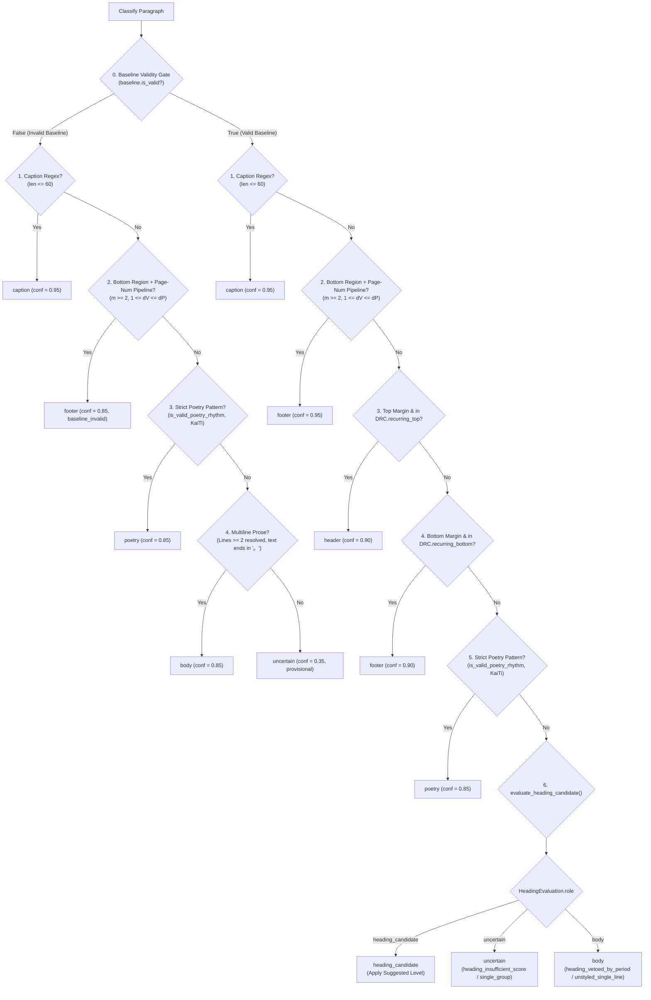

# Phase 2 — P1 Layout Classifier Specification & Design (Rev 3.4 Final Contract Amendment & Design Freeze)

## Goal Description

Establish the technical specification for **Phase 2 (P1 Layout Classifier)** to achieve **Final Design Freeze**. Phase 2 ingests structurally reconstructed `ParagraphRecord` objects from Phase 1 (`src/scripts/paragraph_reconstruction.py`) alongside line records (`LineRecord`) and page geometries (`PageGeometry`), returning decoupled, immutable classification records (`ParagraphClassification`) without modifying Phase 1 records or performing disk I/O.

Rev 3.4 incorporates the final contractual closures:

1. **P0-1: Three-State `LineStructureStatus` & Fallback Precedence**:
   - `LineStructureStatus = Literal["verified_single_line", "verified_multiline", "unavailable"]`.
   - When `line_status == "unavailable"`: line count cannot be verified. Unstyled text ending in `。` yields `primary_evidence="body: unverified_lines_single_line_fallback"`, $conf=0.60$.
   - When `line_status in ("verified_single_line", "verified_multiline")`: normal Period Veto yields `primary_evidence="body: heading_vetoed_by_period"`, $conf=0.85$.
2. **P0-2: Question Mark Veto Matrix Across Line States**:
   - Chapter prefix (`"chapter"`): proceeds to Heading Gate under all line states (LC-08).
   - Non-chapter (`"section"`, `"subsection"`, or `None`):
     - `verified_multiline`: classified as `role="body"`, `primary_evidence="body: multiline_prose_flow"`, $conf=0.85$ (LC-08c).
     - `verified_single_line` or `unavailable`: quarantined to `role="uncertain"`, `primary_evidence="uncertain: standalone_question_without_prefix"`, $conf=0.35$ (LC-08b).
3. **P0-3: Closed Two-Tier Evidence Registry & Ordering**:
   - `VALID_EVIDENCE_TOKENS`: all allowable Primary and Secondary tokens defined as an immutable `frozenset`.
   - `ROLE_PRIMARY_EVIDENCE_MAP`: maps each `SemanticRole` strictly to its allowed `evidence[0]`.
   - Secondary diagnostic tokens (`"geo: missing_page_geometry"`, etc.) strictly follow primary token. Zero duplicate tokens, zero empty tuples.
4. **P0-4: Complete Specification Inheritance Clause**:
   - Formally inherits and freezes: 4-stage Typography Baseline Clean Pool, DocumentRepetitionContext extraction, CJK Numeral Parser grammar table, Caption regex lookahead, Poetry couplet rhythm contract, Footer monotonic sequence with page-level vertical conflict isolation, and global structural input integrity checks.
5. **P1-1: `HeadingEvaluation` Internal Invariant Validation**:
   - `__post_init__` enforces: `qualified=True` requires `role="heading_candidate"` and `suggested_level in (1, 2, 3)`; `qualified=False` requires `role in ("body", "uncertain")` and `suggested_level=None`.
6. **P1-3: Exact 57-Case Verification & Explicit Disk I/O Mock Scope**:
   - Verifies all 9 fields across 45 LC cases + 12 Edge cases.
   - Zero disk I/O test specifically mocks `builtins.open`, `io.open`, `os.open`, `Path.open`, `Path.read_text`, `Path.read_bytes`, `Path.write_text`, `Path.write_bytes`, and `Path.mkdir` strictly during execution of `classify_layout()`.

---

## 1. Input Contracts, Data Integrity & Interface Boundaries

### 1.1 Public Entry Point & Output Immutability

```python
from types import MappingProxyType
from typing import Literal, Mapping, Optional, Sequence, Tuple, List, Set, Dict, Any, FrozenSet
from dataclasses import dataclass
import math, re
from decimal import Decimal, ROUND_HALF_UP

SemanticRole = Literal[
    "body",
    "heading_candidate",
    "caption",
    "header",
    "footer",
    "poetry",
    "uncertain",
]
HeadingLevel = Literal[1, 2, 3]
ActiveGroup = Literal["A", "B", "C"]
LineStructureStatus = Literal["verified_single_line", "verified_multiline", "unavailable"]

VALID_ROLES: FrozenSet[str] = frozenset({
    "body",
    "heading_candidate",
    "caption",
    "header",
    "footer",
    "poetry",
    "uncertain",
})

VALID_EVIDENCE_TOKENS: FrozenSet[str] = frozenset({
    # Primary Tokens
    "caption: table_or_figure_prefix",
    "footer: page_number_sequence_valid",
    "footer: page_number_valid_baseline_invalid",
    "footer: recurring_bottom_pattern",
    "header: recurring_top_pattern",
    "poetry: metric_couplet_rhythm_kaiti",
    "heading: level_1_candidate",
    "heading: level_2_candidate",
    "heading: level_3_candidate",
    "body: multiline_prose_flow",
    "body: heading_vetoed_by_period",
    "body: unstyled_single_line",
    "body: unverified_lines_single_line_fallback",
    "uncertain: heading_single_group_quarantine",
    "uncertain: heading_insufficient_score",
    "uncertain: invalid_baseline_quarantine",
    "uncertain: single_page_occurrence",
    "uncertain: isolated_page_number",
    "uncertain: page_level_vertical_conflict",
    "uncertain: broken_page_number_sequence",
    "uncertain: poetry_unresolved_lines",
    "uncertain: poetry_rhythm_without_kaiti_font",
    "uncertain: standalone_question_without_prefix",
    # Secondary Diagnostic Tokens
    "geo: missing_page_geometry",
    "geo: pitch_unverified_missing_lines",
    "geo: spacing_above_dominant",
    "geo: centered_alignment",
    "typo: major_size_delta(+35%)",
    "typo: minor_size_delta(+20%)",
    "typo: bold_weight",
    "typo: title_font_family",
    "lex: chapter_prefix",
    "lex: section_prefix",
    "lex: subsection_prefix",
})

ROLE_PRIMARY_EVIDENCE_MAP: Mapping[str, FrozenSet[str]] = MappingProxyType({
    "caption": frozenset({"caption: table_or_figure_prefix"}),
    "footer": frozenset({
        "footer: page_number_sequence_valid",
        "footer: page_number_valid_baseline_invalid",
        "footer: recurring_bottom_pattern",
    }),
    "header": frozenset({"header: recurring_top_pattern"}),
    "poetry": frozenset({"poetry: metric_couplet_rhythm_kaiti"}),
    "heading_candidate": frozenset({
        "heading: level_1_candidate",
        "heading: level_2_candidate",
        "heading: level_3_candidate",
    }),
    "body": frozenset({
        "body: multiline_prose_flow",
        "body: heading_vetoed_by_period",
        "body: unstyled_single_line",
        "body: unverified_lines_single_line_fallback",
    }),
    "uncertain": frozenset({
        "uncertain: heading_single_group_quarantine",
        "uncertain: heading_insufficient_score",
        "uncertain: invalid_baseline_quarantine",
        "uncertain: single_page_occurrence",
        "uncertain: isolated_page_number",
        "uncertain: page_level_vertical_conflict",
        "uncertain: broken_page_number_sequence",
        "uncertain: poetry_unresolved_lines",
        "uncertain: poetry_rhythm_without_kaiti_font",
        "uncertain: standalone_question_without_prefix",
    }),
})

PRIMARY_CONFIDENCE_MAP: Mapping[str, float] = MappingProxyType({
    "caption: table_or_figure_prefix": 0.95,
    "footer: page_number_sequence_valid": 0.95,
    "footer: page_number_valid_baseline_invalid": 0.85,
    "footer: recurring_bottom_pattern": 0.90,
    "header: recurring_top_pattern": 0.90,
    "poetry: metric_couplet_rhythm_kaiti": 0.85,
    "heading: level_1_candidate": 0.90,
    "heading: level_2_candidate": 0.80,
    "heading: level_3_candidate": 0.80,
    "body: multiline_prose_flow": 0.85,
    "body: heading_vetoed_by_period": 0.85,
    "body: unstyled_single_line": 0.60,
    "body: unverified_lines_single_line_fallback": 0.60,
    "uncertain: heading_single_group_quarantine": 0.40,
    "uncertain: heading_insufficient_score": 0.40,
    "uncertain: invalid_baseline_quarantine": 0.35,
    "uncertain: single_page_occurrence": 0.35,
    "uncertain: isolated_page_number": 0.35,
    "uncertain: page_level_vertical_conflict": 0.35,
    "uncertain: broken_page_number_sequence": 0.35,
    "uncertain: poetry_unresolved_lines": 0.35,
    "uncertain: poetry_rhythm_without_kaiti_font": 0.35,
    "uncertain: standalone_question_without_prefix": 0.35,
})

def classify_layout(
    paragraphs_by_page: Mapping[int, Sequence[ParagraphRecord]],
    lines_by_page: Mapping[int, Sequence[LineRecord]],
    page_geometries: Mapping[int, PageGeometry],
) -> Mapping[str, ParagraphClassification]:
    """
    Main entry point for Phase 2 layout classification:
    1. Validates input integrity (rejects duplicates and key mismatches with ValueError).
    2. Internally computes DocumentTypographyBaseline via 4-stage clean pool.
    3. Internally computes DocumentRepetitionContext across observed pages.
    4. Evaluates paragraph roles strictly according to Section 3.1 Precedence Pipeline.
    5. Returns an immutable MappingProxyType mapping paragraph_id -> ParagraphClassification.
    Zero disk I/O; zero mutation on input Phase 1 objects.
    """
```

### 1.2 Output Contract Dataclass (P0-3 Runtime Immutability)

```python
@dataclass(frozen=True)
class ParagraphClassification:
    paragraph_id: str
    page_num: int
    semantic_role: SemanticRole
    suggested_heading_level: Optional[HeadingLevel]
    confidence: float
    is_provisional: bool
    evidence: Tuple[str, ...]
    active_groups: Tuple[ActiveGroup, ...]
    score: float

    def __post_init__(self):
        # 1. Identity & Page (excludes bool)
        if type(self.paragraph_id) is not str or not self.paragraph_id.strip():
            raise ValueError(f"Invalid paragraph_id: {self.paragraph_id}")
        if type(self.page_num) is not int or isinstance(self.page_num, bool) or self.page_num < 1:
            raise ValueError(f"page_num must be positive int (non-bool), got {self.page_num}")
        
        # 2. Roles & Levels
        if type(self.semantic_role) is not str or self.semantic_role not in VALID_ROLES:
            raise ValueError(f"Invalid semantic_role: {self.semantic_role}")
        if self.suggested_heading_level is not None:
            if type(self.suggested_heading_level) is not int or isinstance(self.suggested_heading_level, bool) or self.suggested_heading_level not in (1, 2, 3):
                raise ValueError(f"Invalid suggested_heading_level: {self.suggested_heading_level}")
        
        # Cross-field consistency
        if self.semantic_role == "heading_candidate" and self.suggested_heading_level not in (1, 2, 3):
            raise ValueError(f"heading_candidate requires suggested_heading_level in (1, 2, 3), got {self.suggested_heading_level}")
        if self.semantic_role != "heading_candidate" and self.suggested_heading_level is not None:
            raise ValueError(f"Non-heading role {self.semantic_role} must have suggested_heading_level=None")

        # 3. Numeric bounds (strict non-bool finite)
        if type(self.confidence) not in (float, int) or isinstance(self.confidence, bool) or not math.isfinite(self.confidence) or not (0.0 <= self.confidence <= 1.0):
            raise ValueError(f"confidence must be finite in [0.0, 1.0], got {self.confidence}")
        if type(self.score) not in (float, int) or isinstance(self.score, bool) or not math.isfinite(self.score) or not (0.0 <= self.score <= 1.0):
            raise ValueError(f"score must be finite in [0.0, 1.0], got {self.score}")
        if type(self.is_provisional) is not bool:
            raise ValueError(f"is_provisional must be bool, got {self.is_provisional}")
        if self.semantic_role == "uncertain" and not self.is_provisional:
            raise ValueError("uncertain role must have is_provisional=True")
        if self.semantic_role != "uncertain" and self.is_provisional:
            raise ValueError(f"Non-uncertain role {self.semantic_role} must have is_provisional=False")

        # 4. Evidence & Groups
        if type(self.evidence) is not tuple or len(self.evidence) == 0:
            raise ValueError(f"evidence must be non-empty Tuple[str, ...], got {self.evidence}")
        for e in self.evidence:
            if type(e) is not str or e not in VALID_EVIDENCE_TOKENS:
                raise ValueError(f"Invalid evidence token: '{e}'")
        
        primary_token = self.evidence[0]
        valid_primaries = ROLE_PRIMARY_EVIDENCE_MAP[self.semantic_role]
        if primary_token not in valid_primaries:
            raise ValueError(f"Primary evidence token '{primary_token}' is not valid for semantic_role '{self.semantic_role}'. Allowed: {valid_primaries}")
        if len(set(self.evidence)) != len(self.evidence):
            raise ValueError(f"evidence contains duplicate tokens: {self.evidence}")

        # Confidence must match canonical primary confidence
        expected_conf = PRIMARY_CONFIDENCE_MAP.get(primary_token)
        if expected_conf is not None and abs(self.confidence - expected_conf) > 1e-4:
            raise ValueError(f"confidence {self.confidence} does not match expected {expected_conf} for primary token '{primary_token}'")

        if type(self.active_groups) is not tuple or not all(g in ("A", "B", "C") for g in self.active_groups):
            raise ValueError(f"active_groups must be Tuple[ActiveGroup, ...], got {self.active_groups}")
        if len(set(self.active_groups)) != len(self.active_groups):
            raise ValueError(f"active_groups cannot contain duplicates: {self.active_groups}")
        if list(self.active_groups) != sorted(self.active_groups):
            raise ValueError(f"active_groups must be canonically sorted, got {self.active_groups}")
```

### 1.3 Input Data Integrity & Validation Contract (P0-4 Inheritance)

Before computing baselines or classifying paragraphs, `classify_layout` strictly validates all input mappings:

1. **Page Number Key Consistency**:
   - For every `page_num, paras in paragraphs_by_page.items()`:
     If type(page_num) is not int or isinstance(page_num, bool) or page_num < 1:
         raise ValueError(f"Mapping key page_num must be positive int, got {page_num}")
     If any `para.page_num != page_num`, immediately raise `ValueError(f"Mapping key page_num {page_num} mismatches para.page_num {para.page_num}")`.
   - For every `page_num, lines in lines_by_page.items()`:
     If any `line.page_num != page_num`, immediately raise `ValueError(f"Mapping key page_num {page_num} mismatches line.page_num {line.page_num}")`.
2. **Global Paragraph ID Uniqueness**:
   A global set tracks all paragraph IDs across all pages.
   If any `para.paragraph_id` appears more than once across the entire document, immediately raise `ValueError(f"Duplicate paragraph_id detected: {para.paragraph_id}")`.
3. **Line ID Uniqueness Within Page**:
   For every `page_num, lines in lines_by_page.items()`:
   If any `line.line_id` is duplicated on that page, immediately raise `ValueError(f"Duplicate line_id detected on page {page_num}: {line.line_id}")`.
4. **Coordinate Geometry Invariant**:
   For any bounding box in `ParagraphRecord`, `LineRecord`, or `PageGeometry`:
   All 4 coordinates must be finite. If $x_1 < x_0$ or $y_1 < y_0$, immediately raise `ValueError(f"Invalid bounding box coordinates (inverted boundary): {bbox}")`.
5. **Localized Missing Data Fallbacks (ADR-011)**:
   - If `para.page_num not in page_geometries`:
     Paragraph is excluded from top/bottom DRC slots; spacing calculations return sentinel `-1.0`; centered alignment returns $0.0$; token `geo: missing_page_geometry` recorded.
   - If `para.page_num not in lines_by_page` OR `ParagraphRecord` references a `line_id` not found in `lines_by_page[para.page_num]`:
     - Excluded from clean pool and inter-line pitch calculation.
     - Under `poetry`: quarantined to `uncertain` (`evidence: ("uncertain: poetry_unresolved_lines",)`).
     - Under `body`: cannot be verified as multiline body ($conf = 0.85$); falls back to single-line body ($conf = 0.60$, `evidence: ("body: unverified_lines_single_line_fallback",)`).

---

### 1.4 Unified PyMuPDF Coordinate System Convention

All bounding boxes adhere strictly to PyMuPDF page coordinates:

- **Origin $(0.0, 0.0)$**: Strictly the **Top-Left** corner of the page.
- **X-axis**: Points horizontally to the right ($x \ge 0.0$).
- **Y-axis**: Points vertically downwards ($y \ge 0.0$).
- **Bounding Box Tuple**: `(x0, y0, x1, y1)` where:
  - `bbox[0] = x0`: Left boundary.
  - `bbox[1] = y0`: Top boundary.
  - `bbox[2] = x1`: Right boundary.
  - `bbox[3] = y1`: Bottom boundary.
  - Invariant: $x_0 \le x_1$ and $y_0 \le y_1$.
- **Inter-line pitch** for adjacent lines $k, k+1$ ($k+1$ is physically below $k$):
  $$\Delta y = \text{line}_{k+1}.\text{bbox}[1] - \text{line}_k.\text{bbox}[1] \quad (\Delta y > 0)$$
- **Horizontal center**:
  $$x_{\text{center}} = \frac{\text{bbox}[0] + \text{bbox}[2]}{2.0}$$

---

### 1.5 Poetry Data Provenance & Verse Meter Contract

| Field / Object | Authorized Role in Classification | Exclusion |
| :--- | :--- | :--- |
| `ParagraphRecord.text` | **Sole source of truth** for paragraph-level semantics, lexical regex matching (`第X章`, `第一節`), terminal punctuation (`。`, `？`), and total character counts. | Does not contain per-line physical boundary tokens. |
| `LineRecord.bbox` | Geometric line coordinates, indentation, and inter-line pitch calculation. | — |
| `LineRecord.line_order` | Deterministic reading line order. | — |
| `LineRecord.text` | **Structural token length provider for Poetry only**: Character counts per physical line are measured by stripping whitespace and fullwidth/halfwidth punctuation: `re.sub(r'[\s\u3000\u2000-\u200b，。！？、；：“”‘’（）《》〈〉【】—…·]+', '', line.text)`. | Strictly excluded from general semantic/lexical role classification. |

---

### 1.6 Executable 4-Stage Typography Baseline Clean Pool

1. **Stage 1: Geometry Exclusion (Baseline Clean Pool Only)**:
   For each paragraph in `paragraphs_by_page`:
   - If `para.page_num in page_geometries`:
     - Exclude from baseline calculation pool if `para.bbox[3] <= geo.content_top` and `geo.content_top > 0.0`.
     - Exclude from baseline calculation pool if `para.bbox[1] >= geo.content_bottom` and `geo.content_bottom < geo.height`.
     - Note: Geometry exclusion only excludes the paragraph from the baseline calculation pool; it NEVER deletes or drops the paragraph from document classification!
   - If `para.page_num not in page_geometries` or `geo.content_top <= 0.0`: keep paragraph in pool (do not guess geometry).
2. **Stage 2: Semantic Exclusion**:
   From paragraphs surviving Stage 1, exclude if:
   - Short text: `len(para.text.strip()) <= 10` Unicode code points.
   - Unified Hardened Caption regex match: `re.match(r'^(?i:(?:表|图|圖|Table|Figure))\s*\d+(?:[\-\.]\d+)*(?=[.、:：\s]|$)', para.text.strip())`.
   - Chapter heading regex match: `re.match(r'^第[一二三四五六七八九十百\d]+[章卷篇]', para.text.strip())`.
3. **Stage 3: Font Size Outlier Exclusion (Pre-Cut Clean Pool)**:
   The surviving paragraphs form the **Pre-Cut Clean Pool**.
   - Quantize font sizes using pure Decimal step formula:

     ```python
     def quantize_font_size(size: float, step: float = 0.25) -> float:
         if type(size) not in (float, int) or isinstance(size, bool) or not math.isfinite(size) or size <= 0.0:
             raise ValueError(f"Invalid font size: {size}")
         if type(step) not in (float, int) or isinstance(step, bool) or not math.isfinite(step) or step <= 0.0:
             raise ValueError(f"Invalid quantization step: {step}")
         d = Decimal(str(size))
         s = Decimal(str(step))
         return float((d / s).quantize(Decimal('1'), rounding=ROUND_HALF_UP) * s)
     ```

   - Collect unique quantized font sizes: $S_{\text{distinct}} = \text{sorted}(\text{unique}(para.dominant\_size), \text{reverse}=\text{True})$.
   - Set $k = \text{len}(S_{\text{distinct}})$.
   - If $k \ge 4$:
     - $n_{\text{excluded}} = \max(1, \lceil 0.10 \times k \rceil)$.
     - Excluded sizes set: $S_{\text{outliers}} = \{ S_{\text{distinct}}[0], \dots, S_{\text{distinct}}[n_{\text{excluded}} - 1] \}$.
     - Exclude any paragraph whose quantized `dominant_size` is in $S_{\text{outliers}}$.
   - Else ($k < 4$): $n_{\text{excluded}} = 0$; no size outliers excluded.
4. **Stage 4: Threshold & Mode Calculation**:
   The surviving paragraphs form the **Final Clean Typography Pool**.
   - $\text{total\_clean\_characters} = \sum_{p \in \text{final\_pool}} \text{len}(p.\text{text.strip()})$ (Unicode code points).
   - If $\text{total\_clean\_characters} < 50$:
     - `is_valid = False`
     - `body_font = ""`
     - `body_size = 0.0`
     - `standard_line_pitch = 0.0`
     - `rejection_reasons = ("insufficient_clean_characters",)`
   - Else:
     - `is_valid = True`
     - `body_font`: Font family with maximum aggregated characters in final pool (tie-break: alphabetical `min(fonts)`).
     - `body_size`: Quantized size with maximum aggregated characters within `body_font` (tie-break: numerical `max(sizes)`).
     - `standard_line_pitch`: Median of all inter-line pitches ($y_{0, k+1} - y_{0, k}$) from multiline paragraphs in final clean pool whose `source_line_ids` are fully resolved. Fallback if no multiline clean paragraphs exist: $\text{round}(body\_size \times 1.4, 2)$.

---

## 2. Context Builders & Determinism

### 2.1 DocumentRepetitionContext & Boundary Guards

```python
@dataclass(frozen=True)
class DocumentRepetitionContext:
    recurring_top_patterns: Tuple[Tuple[str, float], ...]      # ((normalized_pattern, median_y1), ...)
    recurring_bottom_patterns: Tuple[Tuple[str, float], ...]   # ((normalized_pattern, median_y0), ...)
    page_number_entries: Tuple[Tuple[int, int, str], ...]      # ((page_num, parsed_int, raw_text), ...)
    total_pages_observed: int
    is_multi_page: bool
```

#### Deterministic Slot Construction Algorithm

1. **Multi-Page Flags**:
   - `total_pages_observed = len(paragraphs_by_page)`
   - `is_multi_page = (total_pages_observed >= 2)`
2. **Missing Geometry & Boundary Guard**:
   - If `page_num not in page_geometries`:
     **No** candidate from page `page_num` is registered for Top or Bottom slots. (Do not guess page height from paragraph bboxes).
   - If `page_num in page_geometries`, but `geo.content_top < 0.0` or `geo.content_bottom <= geo.content_top` or `standard_line_pitch <= 0.0`:
     **No** candidate from page `page_num` is registered for Top or Bottom slots (`evidence: "drc: invalid_geometry_boundaries"`).
3. **Text Normalization & Noise Exclusion**:
   - Lowercase and strip whitespace: `s = re.sub(r'[\s\u3000]+', '', text.lower())`
   - Strip trailing page numbers, dates, punctuation: `s = re.sub(r'[\d\-_·*•，。\s]+$', '', s)`
   - **Exclusion**: If `len(s) < 2`, it is strictly excluded from recurring pattern registration.
4. **Top Slot Extraction**:
   - Candidate if `para.bbox[3] <= geo.content_top + 0.5 * pitch` (or `para.bbox[3] <= 0.12 * geo.height` when `content_top == 0.0`).
   - Median position: $\bar{y}_{\text{top}} = \text{median}(\{ \text{para.bbox}[3] \text{ of occurrences} \})$.
   - Matching tolerance: $|\text{para.bbox}[3] - \bar{y}_{\text{top}}| \le \max(12.0, 0.02 \times \text{geo.height})$.
   - Same-page tie-break: Select the **topmost** block (smallest `bbox[1]`).
5. **Bottom Slot Extraction**:
   - Candidate if `para.bbox[1] >= geo.content_bottom - 0.5 * pitch` (or `para.bbox[1] >= 0.88 * geo.height` when `content_bottom == geo.height`).
   - Median position: $\bar{y}_{\text{bottom}} = \text{median}(\{ \text{para.bbox}[1] \text{ of occurrences} \})$.
   - Matching tolerance: $|\text{para.bbox}[1] - \bar{y}_{\text{bottom}}| \le \max(12.0, 0.02 \times \text{geo.height})$.
   - Same-page tie-break: Select the **bottommost** block (largest `bbox[1]`).
6. **Distinct-Page Repetition Threshold**:
   - Pattern qualifies if `len(pages_with_pattern[pattern]) >= k_repeat`, where:
     $$k_{\text{repeat}} = \max(2, \min(3, \lceil 0.05 \times \text{total\_pages\_observed} \rceil))$$
   - Multiple occurrences on the same page count as **1** page occurrence.

---

### 2.2 Hardened CJK/ASCII Numeral Parser Contract

#### Specification Table

| Input Text | Parsed Value | Reason |
| :--- | :---: | :--- |
| `"1"` | `1` | Valid positive ASCII digit ($v \ge 1$). |
| `"12"` | `12` | Valid ASCII digit. |
| `"一"` | `1` | Valid CJK single unit. |
| `"十"` | `10` | Valid CJK ten unit. |
| `"十二"` | `12` | Valid formal CJK number. |
| `"二十"` | `20` | Valid formal CJK number. |
| `"一百零二"` | `102` | Valid formal CJK number. |
| `"- 24 -"` | `24` | Decorative symbols stripped. |
| `"第 15 页"` | `15` | Prefix and suffix stripped. |
| `"0"` | `None` | Non-positive ($v < 1$). |
| `"零"` / `"〇"` | `None` | Non-positive ($v < 1$). |
| `"¹²³"` | `None` | Unicode superscript rejected by `^[0-9]+$`. |
| `"百十"` | `None` | Invalid CJK grammar. |
| `"二二十"` | `None` | Invalid CJK grammar. |
| `"12 / 50"` | `None` | Multi-token slash format deferred to future phase. |
| `"Table 2"` | `None` | Contains non-numeral text. |

```python
CJK_DIGIT_MAP = {
    '〇': 0, '零': 0,
    '一': 1, '二': 2, '三': 3, '四': 4,
    '五': 5, '六': 6, '七': 7, '八': 8, '九': 9
}

def parse_cjk_or_arabic_numeral(raw: str) -> Optional[int]:
    """
    Parses Arabic digits and CJK numeral representations deterministically.
    Returns Optional[int]. Rejects non-positive integers (val < 1) with None.
    """
    if not raw or not raw.strip():
        return None
    
    # 1. Strip decorative symbols and whitespace
    text = re.sub(r'^[·*•\-—~第\s]+|[·*•\-—~页\s]+$', '', raw.strip())
    if not text:
        return None
    
    # 2. ASCII digits (strictly [0-9]+; str.isdigit() is banned to reject superscripts)
    if re.fullmatch(r'[0-9]+', text):
        val = int(text)
        return val if val >= 1 else None
    
    # 3. Positional CJK digits (1 to 4 characters)
    if re.fullmatch(r'[〇零一二三四五六七八九]{1,4}', text):
        val = 0
        for ch in text:
            val = val * 10 + CJK_DIGIT_MAP[ch]
        return val if val >= 1 else None
    
    # 4. Formal CJK numbers with units (百, 十)
    m = re.fullmatch(r'^(?:([一二三四五六七八九])百)?(?:([一二三四五六七八九]?)(十))?(?:[零〇]?([一二三四五六七八九]))?$', text)
    if m:
        hundred_digit, ten_digit, has_ten, unit_digit = m.groups()
        if not hundred_digit and not has_ten and not unit_digit:
            return None
        
        val = 0
        if hundred_digit:
            val += CJK_DIGIT_MAP[hundred_digit] * 100
        if has_ten:
            val += (CJK_DIGIT_MAP[ten_digit] if ten_digit else 1) * 10
        if unit_digit:
            val += CJK_DIGIT_MAP[unit_digit]
        return val if val >= 1 else None
        
    return None
```

---

### 2.3 Deterministic Footer Pipeline & Tolerance Decoupling (P0-2, P1-1)

#### Stage 1: Bottom Region Spatial Filter

A paragraph qualifies as a footer page-number candidate if and only if:
`para.page_num in page_geometries` AND `para.bbox[1] >= geo.content_bottom - 0.5 * baseline.standard_line_pitch`.
Any number in the main body canvas ($y_0 < \text{geo.content\_bottom} - 0.5 \times \text{pitch}$) is immediately excluded from footer evaluation (LC-11c).

#### Stage 2: Numeral Parsing

Candidate must return a valid integer $v \ge 1$ from `parse_cjk_or_arabic_numeral(para.text)`.

#### Stage 3: Decoupled Tolerance & Deterministic Anchor-Based Vertical Clustering

```python
def get_footer_vertical_tolerance(baseline: DocumentTypographyBaseline) -> float:
    if baseline.is_valid:
        return max(3.0, baseline.body_size * 0.35)
    return 3.0

def cluster_vertical_candidates(
    candidates: Sequence[ParagraphRecord],
    tolerance: float,
) -> List[List[ParagraphRecord]]:
    if type(tolerance) not in (float, int) or isinstance(tolerance, bool) or not math.isfinite(tolerance) or tolerance < 0.0:
        raise ValueError(f"tolerance must be finite >= 0.0, got {tolerance}")
    if not candidates:
        return []
    page_nums = {c.page_num for c in candidates}
    if len(page_nums) > 1:
        raise ValueError(f"cluster_vertical_candidates must only receive candidates from single page, got {page_nums}")
    
    sorted_c = sorted(candidates, key=lambda c: (c.bbox[1], c.bbox[0], c.paragraph_id))
    clusters = [[sorted_c[0]]]
    anchor_y0 = sorted_c[0].bbox[1]
    for c in sorted_c[1:]:
        if c.bbox[1] - anchor_y0 <= tolerance:
            clusters[-1].append(c)
        else:
            clusters.append([c])
            anchor_y0 = c.bbox[1]
    return clusters
```

#### Stage 4: Page-Level Vertical Conflict Isolation (Blocker 1)

For each cluster on page $p$:
$$\text{distinct\_values} = \text{set}(m.\text{parsed\_value for } m \in \text{cluster.members})$$
**If ANY cluster on page $p$ has $\text{len}(\text{distinct\_values}) > 1$**:

- The page $p$ has a page-level vertical conflict.
- **Isolation Scope**: Quarantines **ONLY** the candidate paragraphs on page $p$ participating in footer page-number evaluation to `uncertain` (`evidence: ("uncertain: page_level_vertical_conflict",)`). Normal body text, headings, and captions on page $p$ are completely untouched.
- Page $p$ yields **0 valid page numbers** (returns `None`), ensuring isolated candidates on the same page cannot pass (LC-39).

#### Stage 5: Cross-Page Monotonic Sequence Validation

1. Each physical page $p$ contributes at most **1** resolved page number $(p, v_p)$.
2. Collect all resolved pairs sorted by physical page index: $(p_1, v_1), (p_2, v_2), \dots, (p_m, v_m)$ where $p_1 < p_2 < \dots < p_m$.
3. Requires at least **2 distinct pages** ($m \ge 2$). If $m = 1$ in a multi-page document, the single candidate cannot verify sequence $\rightarrow$ quarantined to `uncertain` (`evidence: ("uncertain: isolated_page_number",)`, LC-11b).
4. Monotonic Sequence Formula:
   $$1 \le v_{i+1} - v_i \le p_{i+1} - p_i$$
   - If any adjacent pair violates this (e.g. sequence resets, decreases, or jumps), **all** page numbers in the document fail sequence check $\rightarrow$ quarantined to `uncertain` (`evidence: ("uncertain: broken_page_number_sequence",)`, LC-33).

---

## 3. Decision Rules & Scoring Model

### 3.1 Closed Mathematical Scoring Model

```python
score_A = 0.0
tokens = []

# Group A: Typography (Evaluated ONLY if baseline.is_valid)
if baseline.is_valid:
    if quantized_size >= baseline.body_size * 1.25:
        score_A += 0.35
        tokens.append("typo: major_size_delta(+35%)")
    elif quantized_size >= baseline.body_size * 1.12:
        score_A += 0.20
        tokens.append("typo: minor_size_delta(+20%)")

    if bold_ratio >= 0.70:
        score_A += 0.20
        tokens.append("typo: bold_weight")
    if normalized_font in TITLE_FONT_PATTERNS and normalized_font != baseline.body_font:
        score_A += 0.20
        tokens.append("typo: title_font_family")
score_A = min(score_A, 0.45)

# Group B: Geometry (Rejects -1.0 Sentinels; Pitch checked ONLY if baseline.is_valid and lines resolved)
score_B = 0.0
if (
    spacing_above >= 0.0
    and spacing_below >= 0.0
    and spacing_above >= spacing_below * 1.30
    and baseline.is_valid
    and lines_fully_resolved
    and spacing_above >= baseline.standard_line_pitch * 1.25
):
    score_B += 0.25
    tokens.append("geo: spacing_above_dominant")

if page_width > 0.0 and abs(center_x - (page_width / 2.0)) <= page_width * 0.08:
    score_B += 0.20
    tokens.append("geo: centered_alignment")
score_B = min(score_B, 0.35)

# Group C: Lexical Prefixes
score_C = 0.0
lexical_match = None
if re.match(r'^(?:第[一二三四五六七八九十百\d]+[章卷篇]|Chapter\s*\d+)', text):
    score_C = 0.35
    lexical_match = "chapter"
    tokens.append("lex: chapter_prefix")
elif re.match(r'^(?:第[一二三四五六七八九十百\d]+[节節講回]|\d+\.\d+(?!\.))', text):
    score_C = 0.30
    lexical_match = "section"
    tokens.append("lex: section_prefix")
elif re.match(r'^(?:[一二三四五六七八九十]+[、. ]|\d+\.\d+\.\d+)', text):
    score_C = 0.25
    lexical_match = "subsection"
    tokens.append("lex: subsection_prefix")
score_C = min(score_C, 0.35)

# Closed Mathematical Score: S in [0.0, 1.0]
total_score = min(1.0, score_A + score_B + score_C)
active_groups = tuple(sorted(g for g, s in [("A", score_A), ("B", score_B), ("C", score_C)] if s > 0.0))
```

---

### 3.2 Heading Qualification Gate & Level Resolver (P0-1, P0-2)

```python
@dataclass(frozen=True)
class HeadingEvaluation:
    qualified: bool
    suggested_level: Optional[HeadingLevel]
    confidence: float
    primary_evidence: str
    role: SemanticRole

    def __post_init__(self):
        if self.qualified:
            if self.role != "heading_candidate" or self.suggested_level not in (1, 2, 3):
                raise ValueError(f"Qualified heading must have role='heading_candidate' and level in (1, 2, 3), got {self}")
        else:
            if self.suggested_level is not None or self.role not in ("body", "uncertain"):
                raise ValueError(f"Disqualified heading must have level=None and role in ('body', 'uncertain'), got {self}")
        if not math.isfinite(self.confidence) or not (0.0 <= self.confidence <= 1.0):
            raise ValueError(f"Invalid confidence: {self.confidence}")

def evaluate_heading_candidate(
    para: ParagraphRecord,
    active_groups: Tuple[ActiveGroup, ...],
    total_score: float,
    lexical_match: Optional[str],
    line_status: LineStructureStatus,
) -> HeadingEvaluation:
    """
    Two-stage pipeline:
    Stage A: Gate qualification (Period veto, Question check, 2-group requirement).
    Stage B: Level resolution (strictly called ONLY if Gate passes).
    """
    # Strict type validation
    if type(total_score) not in (float, int) or isinstance(total_score, bool) or not math.isfinite(total_score) or not (0.0 <= total_score <= 1.0):
        raise ValueError(f"total_score must be finite [0.0, 1.0], got {total_score}")
    if lexical_match not in (None, "chapter", "section", "subsection"):
        raise ValueError(f"Unknown lexical_match: {lexical_match}")
    if line_status not in ("verified_single_line", "verified_multiline", "unavailable"):
        raise ValueError(f"Unknown line_status: {line_status}")

    text = para.text.rstrip()

    # 1. Period veto handling (respects line_status)
    if re.search(r'[。]\s*$', text):
        if line_status == "unavailable":
            return HeadingEvaluation(
                qualified=False,
                suggested_level=None,
                confidence=0.60,
                primary_evidence="body: unverified_lines_single_line_fallback",
                role="body",
            )
        return HeadingEvaluation(
            qualified=False,
            suggested_level=None,
            confidence=0.85,
            primary_evidence="body: heading_vetoed_by_period",
            role="body",
        )

    # 2. Question mark check (supports fullwidth ？ and halfwidth ?)
    if re.search(r'[？?]\s*$', text):
        if lexical_match == "chapter":
            pass  # Chapter questions proceed to Gate
        elif line_status == "verified_multiline":
            return HeadingEvaluation(
                qualified=False,
                suggested_level=None,
                confidence=0.85,
                primary_evidence="body: multiline_prose_flow",
                role="body",
            )
        else:
            return HeadingEvaluation(
                qualified=False,
                suggested_level=None,
                confidence=0.35,
                primary_evidence="uncertain: standalone_question_without_prefix",
                role="uncertain",
            )

    # 3. Qualification Gate: requires >= 2 active groups AND total_score >= 0.65
    if len(active_groups) >= 2 and total_score >= 0.65:
        level, conf, ev = resolve_heading_level(lexical_match, total_score)
        return HeadingEvaluation(
            qualified=True,
            suggested_level=level,
            confidence=conf,
            primary_evidence=ev,
            role="heading_candidate",
        )

    # Gate Failed: Differentiate quarantine vs body fallback
    if len(active_groups) >= 2 and total_score < 0.65:
        return HeadingEvaluation(
            qualified=False,
            suggested_level=None,
            confidence=0.40,
            primary_evidence="uncertain: heading_insufficient_score",
            role="uncertain",
        )
    if len(active_groups) == 1 and total_score >= 0.35:
        return HeadingEvaluation(
            qualified=False,
            suggested_level=None,
            confidence=0.40,
            primary_evidence="uncertain: heading_single_group_quarantine",
            role="uncertain",
        )

    # Fall through to body evaluation
    if line_status == "unavailable":
        return HeadingEvaluation(
            qualified=False,
            suggested_level=None,
            confidence=0.60,
            primary_evidence="body: unverified_lines_single_line_fallback",
            role="body",
        )
    is_multi = (line_status == "verified_multiline")
    return HeadingEvaluation(
        qualified=False,
        suggested_level=None,
        confidence=0.85 if is_multi else 0.60,
        primary_evidence="body: multiline_prose_flow" if is_multi else "body: unstyled_single_line",
        role="body",
    )

def resolve_heading_level(
    lexical_match: Optional[str],
    total_score: float,
) -> Tuple[HeadingLevel, float, str]:
    if lexical_match not in (None, "chapter", "section", "subsection"):
        raise ValueError(f"Unknown lexical_match: {lexical_match}")
    if not math.isfinite(total_score) or not (0.65 <= total_score <= 1.0):
        raise ValueError(f"total_score must be in [0.65, 1.0] for qualified heading, got {total_score}")

    # Priority 1: Lexical Override
    if lexical_match == "chapter":
        return 1, 0.90, "heading: level_1_candidate"
    if lexical_match == "section":
        return 2, 0.80, "heading: level_2_candidate"
    if lexical_match == "subsection":
        return 3, 0.80, "heading: level_3_candidate"

    # Priority 2: Typography Score Fallback
    if total_score >= 0.85:
        return 1, 0.90, "heading: level_1_candidate"
    if total_score >= 0.70:
        return 2, 0.80, "heading: level_2_candidate"
    return 3, 0.80, "heading: level_3_candidate"
```

---

### 3.3 Role Precedence Pipeline



---

## 4. Comprehensive Output Policy & Evidence Matrix (P0-3, P1-2)

Compound evidence tuples MUST place the Primary Decision Token first, followed by any secondary diagnostic tokens. Zero empty evidence tuples are allowed.

| Role | Suggested Level | Confidence | Provisional | Canonical Primary Token | Trigger Condition |
| :--- | :--- | :---: | :---: | :--- | :--- |
| **`caption`** | `None` | $0.95$ | `False` | `caption: table_or_figure_prefix` | Lookahead regex match + length $\le 60$. |
| **`footer`** | `None` | $0.95$ | `False` | `footer: page_number_sequence_valid` | Bottom margin folio, $m \ge 2$, monotonic valid. |
| **`footer`** | `None` | $0.85$ | `False` | `footer: page_number_valid_baseline_invalid` | Sequence valid under invalid baseline. |
| **`header`** | `None` | $0.90$ | `False` | `header: recurring_top_pattern` | Matches `DRC.recurring_top`, baseline valid. |
| **`footer`** | `None` | $0.90$ | `False` | `footer: recurring_bottom_pattern` | Matches `DRC.recurring_bottom`, baseline valid. |
| **`poetry`** | `None` | $0.85$ | `False` | `poetry: metric_couplet_rhythm_kaiti` | Lines $\ge 3$, KaiTi font, stripped CJK 5/7 rhythm. |
| **`heading_candidate`** | `1` | $0.90$ | `False` | `heading: level_1_candidate` | 2-group gate passed, level == 1. |
| **`heading_candidate`** | `2` | $0.80$ | `False` | `heading: level_2_candidate` | 2-group gate passed, level == 2. |
| **`heading_candidate`** | `3` | $0.80$ | `False` | `heading: level_3_candidate` | 2-group gate passed, level == 3. |
| **`body`** | `None` | $0.85$ | `False` | `body: multiline_prose_flow` | Resolved lines $\ge 2$, ends in `。`. |
| **`body`** | `None` | $0.85$ | `False` | `body: heading_vetoed_by_period` | Heading features present, but ends in `。`. |
| **`body`** | `None` | $0.60$ | `False` | `body: unstyled_single_line` | Single line, no heading features ($S < 0.35$). |
| **`body`** | `None` | $0.60$ | `False` | `body: unverified_lines_single_line_fallback` | Missing line records ending in `。`. |
| **`uncertain`** | `None` | $0.40$ | `True` | `uncertain: heading_single_group_quarantine` | Heading 2-group gate failed ($S \ge 0.35$). |
| **`uncertain`** | `None` | $0.40$ | `True` | `uncertain: heading_insufficient_score` | 2 groups active, but $0.35 \le S < 0.65$. |
| **`uncertain`** | `None` | $0.35$ | `True` | `uncertain: invalid_baseline_quarantine` | Invalid baseline, non-exception block. |
| **`uncertain`** | `None` | $0.35$ | `True` | `uncertain: single_page_occurrence` | Header/footer candidate in 1-page doc. |
| **`uncertain`** | `None` | $0.35$ | `True` | `uncertain: isolated_page_number` | Single resolved page number in multi-page doc ($m=1$). |
| **`uncertain`** | `None` | $0.35$ | `True` | `uncertain: page_level_vertical_conflict` | Conflicting values in bottom margin cluster. |
| **`uncertain`** | `None` | $0.35$ | `True` | `uncertain: broken_page_number_sequence` | Sequence decrease, jump, or reset. |
| **`uncertain`** | `None` | $0.35$ | `True` | `uncertain: poetry_unresolved_lines` | Poetry candidate missing `LineRecord`. |
| **`uncertain`** | `None` | $0.35$ | `True` | `uncertain: poetry_rhythm_without_kaiti_font` | 5/7 rhythm present, but non-KaiTi font. |
| **`uncertain`** | `None` | $0.35$ | `True` | `uncertain: standalone_question_without_prefix` | Standalone line ending in `？` without chapter prefix. |

---

## 5. Recalculated 57-Case Test Matrix (P1-3)

Every test case strictly verifies all **9 fields** of `ParagraphClassification`:
`paragraph_id`, `page_num`, `semantic_role`, `suggested_heading_level`, `confidence`, `is_provisional`, `evidence`, `active_groups`, `score`.

| Test ID | Scenario | Input Conditions | Score | Groups | Expected Role | Level | Branch & Rule Verified |
| :--- | :--- | :--- | :---: | :---: | :---: | :---: | :--- |
| **LC-01** | Multiline body prose | Body font/size, ends in `。` | $0.00$ | `()` | `body` | `None` | Normal prose flow ($conf = 0.85$). |
| **LC-02** | Short body line | Body font/size, length $\le 25$, ends in `。` | $0.00$ | `()` | `body` | `None` | Period veto triggers ($conf = 0.85$). |
| **LC-03** | Centered short text | Centered ($+0.20$), body font, no prefix | $0.20$ | `('B',)` | `body` | `None` | Single group, $S=0.20 < 0.35 \rightarrow$ body ($conf = 0.60$). |
| **LC-04** | Chapter heading | $+30\%$ size ($0.35$), Heiti ($0.20$, cap $0.45$), spacing ($0.25$), chapter ($0.35$) | $\mathbf{1.00}$ | `('A', 'B', 'C')` | `heading_candidate` | `1` | S capped at $1.00$; 3 groups $\ge 2$, $S \ge 0.65$ ($conf = 0.90$). |
| **LC-05** | Traditional Section | $+15\%$ size ($0.20$), bold ($0.20$), spacing ($0.25$), `第一節` ($0.30$) | $0.95$ | `('A', 'B', 'C')` | `heading_candidate` | `2` | Traditional Chinese `節` recognized ($conf = 0.80$). |
| **LC-05b** | Weak section heading | Bold ($0.20$), section prefix ($0.30$), NO spacing above ($0.0$) | $0.50$ | `('A', 'C')` | `uncertain` | `None` | 2 groups, but $S=0.50 < 0.65 \rightarrow$ quarantine ($conf = 0.40$). |
| **LC-06** | Traditional Subsection | Bold ($0.20$), spacing ($0.25$), `一、` ($0.25$) | $0.70$ | `('A', 'B', 'C')` | `heading_candidate` | `3` | 3 groups $\ge 2$, $S=0.70 \ge 0.65$ ($conf = 0.80$). |
| **LC-07** | Chapter with period | Heading features present, ends in `。` | Vetoed | — | `body` | `None` | Period veto triggers ($conf = 0.85$). |
| **LC-08** | Question chapter | Chapter prefix ($0.35$), size delta ($0.35$), spacing ($0.25$), `？` | $0.95$ | `('A', 'B', 'C')` | `heading_candidate` | `1` | Chapter prefix enables `？` exception ($conf = 0.90$). |
| **LC-08b** | Standalone question | Standalone line ending in `？` without chapter prefix | — | — | `uncertain` | `None` | Non-prefixed question quarantined ($conf = 0.35$). |
| **LC-08c** | Embedded question | Multiline prose ending in `？` | $0.00$ | `()` | `body` | `None` | Multiline prose flow ($conf = 0.85$). |
| **LC-09** | Top recurring header | Verified across 3 distinct pages in DRC | — | — | `header` | `None` | Multi-page repetition verified ($conf = 0.90$). |
| **LC-10** | Single-page header | Top margin, single page observed ($m=1$) | — | — | `uncertain` | `None` | Single-page restriction ($conf = 0.35$, provisional). |
| **LC-11** | Multi-page sequence folio | Pages 1 and 2 with numbers `21`, `22` | — | — | `footer` | `None` | Sequence validation passed ($conf = 0.95$). |
| **LC-11b** | Isolated multi-page folio | Number `24` on page 1 of 100-page document | — | — | `uncertain` | `None` | Blocked by $m \ge 2$ sequence requirement ($conf = 0.35$). |
| **LC-11c** | Body isolated numeral | Numeral `24` in main body canvas ($y_0 < \text{content\_bottom}$) | $0.00$ | `()` | `body` | `None` | Body zone blocks footer exception ($conf = 0.60$). |
| **LC-12** | Line-level poetry | Resolved `LineRecord` stream: 4 lines of 5 chars each in KaiTi | — | — | `poetry` | `None` | Strict 5-character verse pattern verified ($conf = 0.85$). |
| **LC-13** | KaiTi prose quotation | Resolved `LineRecord` stream: 80 chars continuous prose in KaiTi | — | — | `uncertain` | `None` | Line lengths $\ne 5/7$; deferred to P3 ($conf = 0.35$). |
| **LC-14** | Traditional Caption | Prefix `圖 1-1`, length $\le 60$, ends in `。` | — | — | `caption` | `None` | Period allowed; Traditional Chinese recognized ($conf = 0.95$). |
| **LC-15** | Baseline midpoint | Raw `9.624`, `9.625`, `9.626`, `9.700`, `16.880` | — | — | Valid | — | Pure Decimal step: `9.624->9.50`, `9.625->9.75`, `16.880->17.00`. |
| **LC-16** | Insufficient baseline | Clean pool $< 50$ chars | `is_valid=False` | — | Fallback triggers without 12pt default. |
| **LC-17** | Missing PageGeometry | `page_num = 99` not in `page_geometries` | — | — | Valid Fallback | — | `geo_centered = 0.0`, `spacing_above = -1.0`. |
| **LC-18** | Baseline invalid role | `is_valid == False`: evaluate caption and footer folio | — | — | Evaluated | — | Caption $\rightarrow$ `caption`, Folio $\rightarrow$ `footer` ($conf = 0.85$). |
| **LC-19** | CJK numeral folio | CJK numerals `*〇一`, `*〇二` on pages 21, 22 | — | — | `footer` | `None` | CJK numeral parser: 1, 2 $\rightarrow$ sequence valid ($conf = 0.95$). |
| **LC-20** | Duplicate header on same page | Page 1 has 2 identical headers; Page 2 has none | — | — | `uncertain` | `None` | Same page counted as 1 page occurrence ($conf = 0.35$). |
| **LC-21** | Alternating 5/7 poetry | 4 lines alternating 5, 7, 5, 7 characters in KaiTi | — | — | `poetry` | `None` | Strict alternating 5/7 pattern accepted ($conf = 0.85$). |
| **LC-22** | Poetry missing LineRecord | `source_line_ids` contains ID not in `lines_by_page` | — | — | `uncertain` | `None` | Missing line records prevents guessing; quarantine ($conf = 0.35$). |
| **LC-23** | Multiple page-num conflict | Page bottom has two distinct numbers `12  13` at same level | — | — | `uncertain` | `None` | Ambiguous multiple numerals quarantined ($conf = 0.35$). |
| **LC-24** | Invalid baseline fallback | Clean pool has 20 chars; inspect baseline object | — | — | Valid Fallback | — | `body_font == ""`, `body_size == 0.0`, `pitch == 0.0`. |
| **LC-25** | Caption precedence over heading | `图 1-1 第一章 结构图` matches Caption and Chapter regex | — | — | `caption` | `None` | Precedence 1 (Caption) evaluated before Precedence 6 ($conf = 0.95$). |
| **LC-26** | Decimal midpoint stability | Half-up evaluation of Decimal `9.625` vs `9.624` | — | — | Valid | — | Pure Decimal step quantization without float rounding drift. |
| **LC-27** | Header normalized to empty | Running header consists of only spaces, dashes, numbers | — | — | Excluded | — | Normalized string length $< 2$ excluded from DRC patterns. |
| **LC-28** | Decimal NaN / Inf Rejection | `raw_size = float('nan')` or `float('inf')` or `-1.0` | — | — | ValueError | — | Explicit `ValueError` raised on invalid numerical input. |
| **LC-29** | Decimal Step Zero Rejection | `step = Decimal('0')` or `Decimal('-0.25')` or `NaN` | — | — | ValueError | — | Explicit `ValueError` raised on non-positive/non-finite step. |
| **LC-30** | Invalid Baseline Heading Gate | `baseline.is_valid == False`, block has chapter prefix + bold | — | — | `uncertain` | `None` | Group A size blocked; forced `uncertain` quarantine ($conf = 0.35$). |
| **LC-31** | Poetry Non-5/7 Rejection | 4 lines of 6 characters each `(6, 6, 6, 6)` in KaiTi | — | — | `uncertain` | `None` | Rejects non-5/7 patterns despite variance $= 0.0$ ($conf = 0.35$). |
| **LC-32** | Poetry Mixed 5/7 Rejection | 4 lines with lengths `(5, 5, 7, 7)` in KaiTi | — | — | `uncertain` | `None` | Rejects arbitrary mixing; requires strict alternating ($conf = 0.35$). |
| **LC-33** | Footer Decreasing Sequence | Page 1 has `25`, Page 2 has `20` ($\Delta_{\text{val}} = -5$) | — | — | `uncertain` | `None` | Rejects non-monotonic sequence: $\Delta_{\text{val}} < 1$ ($conf = 0.35$). |
| **LC-34** | Group B Sentinel Rejection | `spacing_above = 10.0`, `spacing_below = -1.0` (last line) | $0.00$ | `()` | `body` | `None` | Both spacings must be $\ge 0.0$; sentinel `-1.0` rejected ($conf = 0.60$). |
| **LC-35** | Footer Same-Height Conflict Precedence | Page bottom has `12` (center) and `13` (right) at $\Delta y = 1.0\text{pt}$ | — | — | `uncertain` | `None` | Ambiguity check precedes centering; both quarantined ($conf = 0.35$). |
| **LC-36** | 3-Line Alternating Poetry Rejection | 3 lines with alternating lengths `(5, 7, 5)` in KaiTi | — | — | `uncertain` | `None` | Alternating 5/7 pattern strictly requires $\ge 4$ lines ($conf = 0.35$). |
| **LC-37** | CJK Parser Invalid Formal Numeral | Input text `"百十"` or `"二二十"` | — | — | None | — | Parser rejects illegal CJK grammar forms with `None`. |
| **LC-38** | CJK Parser Unicode Superscript Rejection | Input text `"¹²³"` | — | — | None | — | Strict ASCII regex `^[0-9]+$` rejects Unicode superscripts. |
| **LC-39** | Page-Level Conflict Isolation (Blocker 1) | Candidates $y_0 = 100, 101$ (conflict), $y_0 = 106$ (independent) | — | — | `uncertain` | `None` | Any cluster conflict triggers page-level isolation; 106 quarantined ($conf = 0.35$). |
| **LC-40** | Chapter Prefix Gate Failure | Chapter prefix ($0.35$) alone, no other features | $0.35$ | `('C',)` | `uncertain` | `None` | Chapter prefix CANNOT bypass 2-group gate; quarantined ($conf = 0.40$). |
| **LC-41** | Lexical vs Score Level Priority | Section prefix `第一節` ($0.30$) with high score $S=0.85$ | $0.85$ | `('A', 'B', 'C')` | `heading_candidate` | `2` | Lexical prefix strictly dictates level: Section $\rightarrow$ Level 2 ($conf=0.80$). |
| **LC-42** | Missing Geometry Slot Rejection | `page_num = 99` not in `page_geometries` | — | — | No Slot | — | No Top or Bottom slots registered; no page height guessing. |
| **LC-43** | Duplicate Paragraph ID Rejection | Same `paragraph_id = "p1"` on multiple pages | — | — | ValueError | — | Input integrity check raises `ValueError` on duplicate ID across document. |
| **LC-44** | Page Number Key Mismatch Rejection | Dict key `1` contains paragraph with `para.page_num = 2` | — | — | ValueError | — | Input integrity check raises `ValueError` on key mismatch. |
| **LC-45** | Invalid Baseline Unresolved Line Body | `baseline.is_valid == False`, missing `LineRecord` in lines | — | — | `uncertain` | `None` | Prohibits guessing line count; quarantined to `uncertain` ($conf = 0.35$). |
| **EDGE-01** | Quantization NaN/Inf step | `step = float('nan')` or `float('inf')` or `bool` | — | — | ValueError | — | Non-finite/bool step rejected. |
| **EDGE-02** | Caption Lookahead Boundary | `text = "Table 2abc is invalid"` | — | — | Non-Caption | — | Lookahead `(?=[.、:：\s] | $)` rejects `2abc`. |
| **EDGE-03** | Inverted BBox Geometry | `bbox = (10, 50, 100, 20)` ($y_1 < y_0$) | — | — | ValueError | — | Strict coordinate geometry invariant enforced. |
| **EDGE-04** | Content Top Zero Baseline Safety | `content_top = 0.0` in `PageGeometry` | — | — | Keep in Pool | — | Paragraphs not falsely excluded when top boundary is 0.0. |
| **EDGE-05** | Scoring Saturation Cap | $A=0.45, B=0.35, C=0.35$ | $\mathbf{1.00}$ | `('A', 'B', 'C')` | `heading_candidate` | `1` | Clamped to $1.00$ by formula; post-init validator rejects $>1.0$. |
| **EDGE-06** | Score Boundary Threshold | $S = 0.65$ vs $S = 0.64$ with 2 groups | $0.65$ / $0.64$ | `('A', 'B')` | `heading` / `uncertain` | `3` / `None` | Exact boundary threshold verified. |
| **EDGE-07** | Footer Clustering Anchor Determinism | $y_0 = 100, 102, 104$ with tol $3.0$ | — | — | 2 Clusters | — | Group 1: $[100, 102]$, Group 2: $[104]$ ($104 - 100 > 3.0$). |
| **EDGE-08** | Footer Sequence Reset | Pages 1, 2, 3 have values `10, 11, 1` | — | — | `uncertain` | `None` | Resets quarantined to `uncertain: broken_page_number_sequence`. |
| **EDGE-09** | Short Prose Non-KaiTi Poetry Rejection | 3 lines of 5 characters in SongTi | — | — | `body` / `uncertain` | `None` | Non-KaiTi rejected from poetry. |
| **EDGE-10** | Input Object Immutability | Inspect Phase 1 records after classification | — | — | Identical | — | Zero attribute mutations or list modifications on input objects. |
| **EDGE-11** | Zero Disk I/O Protocol | Mock/spy on `open`, `io.open`, `os.open`, `Path.open`, `Path.read_*`, `Path.write_*`, `Path.mkdir` | — | — | Zero Calls | — | Pure computational execution verified. |
| **EDGE-12** | Runtime Contract Validation | Pass `bool` as integer/float, mutable `list` to evidence, or mismatched primary evidence | — | — | ValueError | — | Rejects Python bool traps, mutable collections, and role-token mismatches. |

---

## 6. Pre-Implementation Verification Protocol

Confirm repository state:

```powershell
git status --short
git diff --name-only
git diff --check
git diff -- phase2_layout_classifier_design_plan.md
```

- Only `phase2_layout_classifier_design_plan.md` has been modified.
- All 57 test cases (45 LC + 12 Edge) verify all 9 fields of `ParagraphClassification`.
- **Ready for implementation authorization.**
